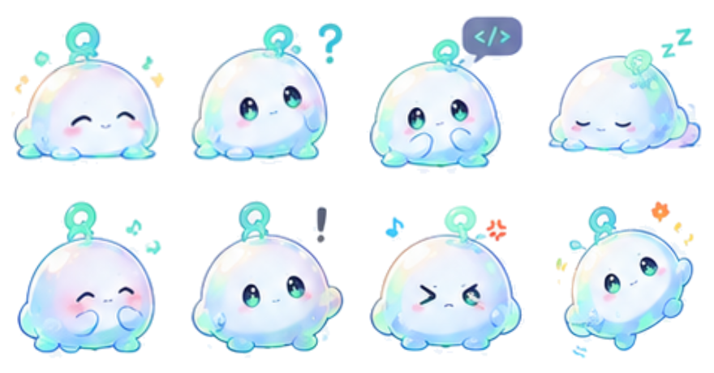

<p align="center">
  
</p>

<h1 align="center">Q豆 · 代码史莱姆</h1>

<p align="center">
  给 Qoder 的桌面宠物插件<br>
  <sub>A quiet code-slime companion for your Qoder desktop.</sub>
</p>

<p align="center">
  
</p>

## 简介

Q豆是一只半透明的薄荷绿代码史莱姆，头顶 Q 形天线，眼睛会发光，安静地待在桌面一角陪你写代码。

它不是提醒工具，也不会打断工作。更多时候，它只是呼吸、漂浮、偶尔挥挥手；当你运行任务、等待结果或遇到失败时，它会用对应的动作回应。

> 这是一个社区项目，非 Qoder 官方产品。Qoder 及相关标识归其各自所有者所有。

## 设计

**角色设定**

- 圆润、软弹的史莱姆体型，没有多余棱角
- 半透明果冻质感，薄荷绿主体配天蓝高光
- Q 形天线呼应 Qoder，也是角色最重要的识别点
- 发光大眼、淡淡腮红、短手短脚，表情克制而友好

**性格**

安静、好奇、可靠。像一个坐在旁边写代码的搭子，不抢注意力，但始终在场。

**动作语言**

- 呼吸与漂浮是基础节奏，幅度小、频率慢
- 移动、挥手、跳跃都带一点果冻般的回弹
- 失败时会短暂泄气，等待时会轻轻晃动
- 整体避免机械式循环，让长时间陪伴更自然

## 功能

- **九种状态动画**：覆盖日常陪伴、移动、互动和工作反馈
- **纯本地运行**：不需要联网、账号、Connector 或 MCP
- **一键安装**：通过插件命令即可安装宠物包
- **不破坏原宠物**：安装为独立宠物，切换与保留由你决定
- **手动选择**：插件不会擅自修改 Qoder 的桌宠设置
- **可校验**：随时检查宠物包是否完整可用

### 状态一览

| 状态 | 表现 |
| --- | --- |
| `idle` | 安静呼吸、轻微漂浮 |
| `running-right` | 向右移动 |
| `running-left` | 向左移动 |
| `waving` | 挥手打招呼 |
| `jumping` | 起跳与落地 |
| `failed` | 失败时短暂失落 |
| `waiting` | 等待输入或结果 |
| `running` | 忙碌工作中 |
| `review` | 审阅代码时专注陪伴 |

## 安装

### 环境要求

- 已支持桌面宠物的 Qoder
- 无需额外安装运行环境、无需登录第三方服务

### 第一步：安装插件

**方式一：插件市场**

插件上架后，在 Qoder 的插件市场中搜索 **Q豆** 或 **Qoder Desktop Pet**，安装并启用。

**方式二：本地导入**

1. 打开 Qoder 的 **扩展 → 插件**。
2. 选择 **添加插件 → 上传 Plugin**。
3. 选择插件 ZIP 包或本地插件目录。
4. 确认安装并启用插件。

### 第二步：安装宠物

在 Qoder 会话中输入：

```text
/pet install
```

插件会把 Q豆 安装为独立桌宠。如果本机已经存在同名宠物，安装会停止并等待你确认，不会直接覆盖。

### 第三步：切换到 Q豆

1. 打开 Qoder 的 **桌宠设置**。
2. 刷新已安装宠物列表。
3. 选择 **Q豆 · 代码史莱姆**。

插件无法代替你切换当前宠物，最后一步需要手动选择。

## 使用

| 命令 | 作用 |
| --- | --- |
| `/pet install` | 安装 Q豆 宠物包 |
| `/pet verify` | 校验已安装的宠物包 |
| `/pet list` | 查看本机已安装的桌宠 |
| `/pet check` | 校验插件内置的宠物包 |

安装完成后，Q豆 会根据当前工作状态自动播放对应动画。你也可以随时在桌宠设置中切回原来的宠物，Q豆 不会被删除。

### 常见问题

**宠物列表里没有 Q豆？**

先刷新桌宠列表；如果仍未出现，重启 Qoder 后再试。

**安装时提示已存在？**

说明本机已有同名宠物。确认要替换后，再按提示执行强制安装。

**切换后没有动画？**

确认当前选中的是 **Q豆 · 代码史莱姆**，并检查 Qoder 版本是否支持桌面宠物。

**如何移除？**

在桌宠设置中切回原宠物，再到插件管理中移除插件即可。宠物文件不会影响 Qoder 的其他功能。

## 技术栈

| 层面 | 方案 |
| --- | --- |
| 角色绘制 | 分层 SVG 矢量角色 |
| 动画 | 逐帧精灵图动画 |
| 插件形态 | Qoder Plugin（Skill + Command） |
| 宠物格式 | Petdex 兼容宠物包 |
| 安装与校验 | Node.js 本地工具 |
| 运行方式 | 纯本地、离线、无后端 |

## 设计来源

Q豆 来自项目作者的原创概念设计：半透明代码史莱姆、Q 形天线、薄荷绿与天蓝配色。项目未使用第三方角色素材。

## 许可证

代码与 Q豆 角色素材以 [MIT License](LICENSE) 发布。转载或再分发前，请确认你拥有相应素材的使用权。
